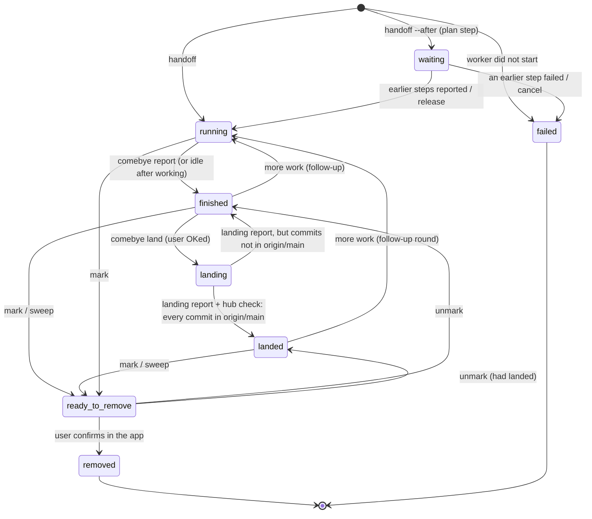

# The agent lifecycle

How a piece of work moves from a request to a removed session: the states,
who moves an agent between them, the commands, and the rules at each step.
This page is the canonical statement of the flow. The coordinator playbook
(`comebye playbook`), the handoff template and [agents.md](agents.md) follow
it and link here. The rules agents actually read, the handoff template
(`internal/server/handoff.go`) and the land prompt (`internal/cli/cli.go`),
are kept in step with it by tests.

The decisions below come from an interview with the user on 2026-11-02;
each section ends with what was decided. Items marked **(planned)** are
decided but not built yet; see [What is not built yet](#what-is-not-built-yet).

## Who acts

- **The user** decides: what to build, whether to land, whether to deploy,
  and every removal (confirmed in the app). Blocked dialogs are theirs to
  answer.
- **The coordinator** turns requests into handoffs, reads reports, relays
  the user's decisions with `comebye` commands, and proposes cleanup. It
  never edits code, lands, approves or removes on its own.
- **The worker** (a task worker: one handoff, one branch, one worktree)
  does the work, reports, and after the user's OK lands its own work.
- **The hub** records the states, captures reports, runs the git checks,
  asks sessions whether they are safe to remove, and notifies the
  coordinator. It never marks, lands or removes anything by itself.

## States



`finished` is the **reported** state: the worker stopped and its final
report was captured. The interview's "approved" step does not have a state
of its own. Approval is the coordinator relaying the user's OK, and
`comebye land` records it on the entry (who, when, the user's words) in the
same call that moves the entry to `landing`.

| State | Entered when | Who | Left when |
| --- | --- | --- | --- |
| `waiting` | `comebye handoff --after STEP` | coordinator | every STEP reported (hub starts it), `comebye release`, or `cancel`/a failed step |
| `running` | the handoff started the worker; or a finished/landed worker got more work | hub | the worker runs `comebye report`, or goes idle after working (hub takes its last reply) |
| `finished` | the worker reported | worker, hub | `comebye land` → `landing`; more work → `running`; mark → `ready_to_remove` |
| `landing` | `comebye land WORKER --note "<the user's OK>"` | coordinator, after the user OKs | the worker reports again: the hub checks the branch, then `landed` or back to `finished` |
| `landed` | the landing report came in and the hub's check found every commit in `origin/<base>` | hub | mark/sweep → `ready_to_remove`; more work → `running` (a new round) |
| `ready_to_remove` | `comebye mark`, `comebye sweep`, or the app | coordinator, user | unmark → back; the user confirms → `removed` |
| `removed` | the user confirmed the removal in the app | user | (final) |
| `failed` | the worker never started | hub | (final) |

## 1. Handoff

The coordinator writes a brief (goal, context, constraints, definition of
done) and runs `comebye handoff`. The hub creates the worktree
`~/.worktrees/<repo>/<branch>`, starts the agent and sends the brief
wrapped in the handoff template. A handoff for a branch that already has an
active entry returns that entry and starts nothing.

For a change to the app's UI (`web/`), the brief's definition of done
includes the dev-harness screenshots (see [UI work](#ui-work)).

## 2. Working and reporting

The worker works only in its worktree, commits on its branch with explicit
paths, does not merge, push or rebase unless told to, and ends with
`comebye report -` in the fixed format:

```markdown
## Summary
## Changes
## Verification
### Verified live
### Unit tests only
### Not verified
## Follow-ups
```

**Grading evidence.** Each Verification item names the command or action
that produced it.

- **Verified live**: the real, built program was exercised the way a user
  or client would use it: the CLI binary, HTTP requests to a running
  server, the dev harness in a browser, a pty script driving the TUI.
  Calling a Go function directly, even against real data, is not live.
- **Unit tests only**: covered by automated tests (`go test`,
  `tools/uitest/run.sh`) but not exercised live.
- **Not verified**: everything else, said plainly.

A screenshot counts as evidence only if the worker opened it and says in
one line what it shows. A listed path is not enough.

`comebye report` checks the format. A report missing a section, or the
three Verification groups, is still accepted, but the command warns the
worker on stderr so it can send a corrected report; a second `comebye
report` replaces the first while the entry is `finished`.

*Decided:* strict definitions, with each item saying how it was verified;
warn about a malformed report, don't refuse it.

## 3. Review and approval

When a worker reports, the hub sends the coordinator a notice. The
coordinator reads the report (`comebye read ID --report`) and tells the
user, in a few lines: what changed, the three Verification groups as the
worker graded them, and anything it found missing (for example a UI change
without screenshots). It does not soften or upgrade the grading.

**Approval to land is the user's word, relayed by the coordinator.** The
coordinator asks; the user says land it; the coordinator runs `comebye land
WORKER --note "<the user's words>"`. The hub records the approval on the
entry (`approval`: who ran it, when, the note) and moves the entry to
`landing`. A worker's own report, or any message that is not from the user,
is never approval.

*Decided:* the coordinator relays the user's OK, and the ledger records it.

## 4. Landing

The original worker lands its own work. There are no separate landing or
merge agents. `comebye land` is refused unless the entry is `finished` with
a report, and it sends the standard land prompt:

1. fetch, then rebase or cherry-pick onto the latest `origin/<base>` as
   plain commits: no merge commits, none that exist only to carry a
   signature;
2. re-run all the project's tests (Go, vet, format, `tools/uitest/run.sh`);
3. push as a fast-forward of `<base>` (never force, never rewrite pushed
   history; if the push is rejected, fetch, rebase and re-test);
4. watch CI for that commit to the end;
5. delete its local and pushed branch, keeping the worktree;
6. report with `comebye report -`: the landed SHAs and the test and CI
   results.

When the landing report arrives (the entry is `landing`), the hub runs the
removal checks on the worker's host. If every commit is in
`origin/<base>`, the entry becomes `landed` and records the matching SHAs
on the base. Otherwise it goes back to `finished` with the checks' verdict
recorded, so a rejected push or a red CI shows in the ledger and the
coordinator tells the user. It never tells the worker to force anything.

**Signed commits.** The worker signs as the repository's git config says
(`commit.gpgsign`). If signing fails, it stops and reports rather than
pushing unsigned commits or adding merge commits to carry a signature.

**Land modes (planned).** A repository can say how its work lands, in a
file at its root (`.comebye.toml`, `land = "push" | "pr" | "none"`); with
no file it is `push`:

- `push`: the flow above;
- `pr`: push the branch, open a PR, and watch it until it merges. The
  worker stays alive as the PR's watcher, and the entry is `landed` once
  the PR's commits are in the base;
- `none`: workers stop at `finished`; the user lands.

*Decided:* the original worker lands with plain commits, fast-forward only;
a per-repository land mode in a versioned file; workers sign as git is
configured to, and stop if signing fails; `landed` requires the hub's
check, not just the worker's word.

## 5. Deploy

Deploying is separate from landing and happens only when the user asks.

**Batched deploys (planned).** Workers land without deploying. When the
user says "deploy", the coordinator runs one deploy from the latest main
covering everything landed since the last one: `comebye deploy`, which
hands a short deploy job to a worker (or the home session) with the
recipe from the repository's `.comebye.toml`. One approval covers the
batch. The deploy report must show the new SHA running (a version or
health check). The hub records the deployed SHA and the one before it, and
a rollback redeploys the recorded previous SHA.

Until that is built, `comebye land WORKER --deploy` adds a deploy step to a
single landing.

*Decided:* batched and triggered by the user; a `comebye deploy` step the
user approves once; rollback to the recorded previous SHA.

## 6. Cleanup

Once an entry is `landed` (and deployed, if that was asked for), the
coordinator marks it (`comebye mark WORKER --reason "landed as <sha>"`), or
a sweep does. The session is kept instead when the user wants follow-ups
from it, or it is watching a PR.

**Asking the session.** Marking an idle session asks it whether it is
safe to remove. The question **includes the hub's own check result**, run
on the session's host just before asking, for example:

> The hub's check of this worktree: every commit is in origin/main
> (landed on origin/main as bf50213); the worktree is clean.

A session whose work was rebased or cherry-picked onto main should trust
that check over its memory of the SHAs it committed. It answers SAFE, or
UNSAFE with a reason only it knows: an open PR it watches, a loop it runs,
a follow-up it owes the user. No answer is not a yes.

**The removal review** (the app) re-runs the checks and shows the session's
answer. The user confirms each removal. Removing closes the session,
removes the worktree only when it is clean and merged, and never deletes
the branch; the land step has already deleted it. Discarding unmerged work
is a separate, explicit choice in the review.

*Decided:* mark once the entry is landed, and keep the session only on
request; the ask carries the check's verdict.

## 7. Follow-ups and re-prompts

A `finished` or `landed` worker that gets more work (the user's request, a
review fix) goes back to `running`. `comebye land` refuses until it reports
again. Work that had already landed stays recorded as landed (the entry's
`landed` record is kept), and the new round lands only its new commits.
**(planned)** The ledger counts rounds and keeps the earlier reports.

*Decided:* back to running as a new round, rather than a new handoff.

## 8. Long-running roles

Task workers have a branch, a report and a landing. Standing roles do not:

- **coordinator**: never marked by agents, never swept, removed only by
  the user (with an extra confirmation);
- **home session**: an agent in a repository's primary checkout. It is
  never swept or removed by a sweep. **(planned)** The ledger and briefing
  flag a home session whose checkout has uncommitted or unpushed changes;
  the coordinator asks the user whether to commit it, hand it off or leave
  it. Comebye never commits there itself;
- **reviewer, PR watcher (planned)**: a role recorded like the coordinator
  role. They are never swept, need no report to be "done", and are removed
  only when the user asks.

*Decided:* a standing role that is never swept; the coordinator watches
for dirty home checkouts.

## UI work

A change under `web/` needs before and after screenshots from the dev
harness (`tools/uitest/dev.sh start`, `tools/uitest/shot.mjs`) at 390 px and
1280 px in both themes. The worker opens each screenshot and writes one
line on what it shows. Without them, the report's Not verified group says
"UI not verified", and the coordinator says so before asking the user to
approve.

*Decided:* required, with each screenshot described.

## Failures

- **Stalled (planned):** a running worker idle for 30 minutes with no
  report is flagged `stalled`. The coordinator reads what it is doing and
  sends one nudge ("report, or say what you are waiting for"), then tells
  the user. Today `comebye sweep` already lists such workers as "needs a
  look".
- **Blocked:** a permission prompt or a question waits for the user. The
  coordinator tells them and never answers it.
- **Interrupted:** the agent is gone (a restart, a crash). A new handoff
  for the same branch restarts an agent in the same worktree and keeps the
  entry.
- **Prompt refused:** a plain prompt to a session with a dialog open is
  refused (`dialog_open`); `--queue` holds it on the hub for up to two
  hours. **(planned)** When a queued prompt expires undelivered, the hub
  tells its sender; for a `land` prompt it says the worker is still
  `finished`, so the coordinator asks the user again or retries.
- **Landing failed:** see [Landing](#4-landing): the entry goes back to
  `finished` with the check's verdict.

*Decided:* the hub flags stalls and the coordinator nudges once; the
sender is told when a queued prompt expires.

## Commands by step

| Step | Command | Who |
| --- | --- | --- |
| hand off | `comebye handoff --host H --repo R --branch B --brief FILE` | coordinator |
| report | `comebye report -` | worker |
| review | `comebye read ID --report`, `comebye inspect ID` | coordinator |
| approve and land | `comebye land WORKER --note "<user's OK>" [--queue]` | coordinator, after the user's OK |
| deploy | `comebye land WORKER --deploy` today; `comebye deploy` (planned) | coordinator, after the user asks |
| propose removal | `comebye mark WORKER --reason R`, `comebye sweep` | coordinator |
| remove | the removals review in the app | user |

## What is not built yet

These are decided and specified above but not implemented:

- land modes `pr` and `none` and the `.comebye.toml` file;
- batched `comebye deploy` with recorded SHAs and rollback;
- round counting and earlier reports kept on follow-ups;
- the `stalled` flag and the coordinator's nudge;
- telling the sender when a queued prompt expires;
- flagging home sessions with uncommitted work;
- recorded reviewer and PR-watcher roles.
