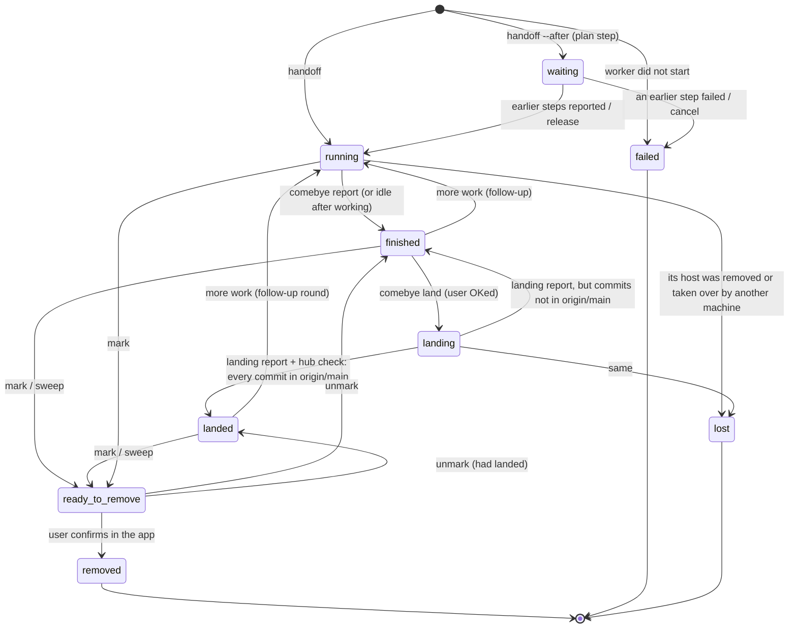

# The agent lifecycle

How a piece of work moves from a request to a removed session: the states,
who moves an agent between them, the commands, and the rules at each step.
This page is the canonical statement of the flow. The coordinator playbook
(`comebye playbook`), the handoff template and [agents.md](agents.md) follow
it and link here. The rules agents actually read, the handoff template
(`internal/server/handoff.go`) and the land prompt (`internal/cli/cli.go`),
are kept in step with it by tests.

The decisions below come from two interviews with the user on 2026-11-02
(the second after the coordinator forwarded the user's input on workflows
and the backlog, and the findings of the beads comparison,
[the beads comparison](https://claude.ai/artifact/UbVjLTGBB9S2HPhjqEbrUD), a Claude artifact);
each section ends with what was decided.

The shape: **one shared lifecycle** (states, report format, evidence
grading, marking and removal), **workflows** that say which parts of it a
handoff uses, **typed waits** that say when something may start, and a
**backlog** on the hub that holds the work before it starts. Items marked **(planned)** are
decided but not built yet; see [What is not built yet](#what-is-not-built-yet).

## Who acts

- **The user** decides: what to build, whether to land, whether to deploy,
  and every removal (confirmed in the app). Blocked dialogs are theirs to
  answer.
- **The coordinator** owns the backlog: it turns requests into backlog
  items and handoffs, picks each handoff's workflow, reads reports, files
  follow-ups, relays the user's decisions with `comebye` commands, starts
  approved items when their waits are met, and proposes cleanup. It never
  edits code, lands, approves or removes on its own.
- **The worker** (a task worker: one handoff, one branch, one worktree)
  does the work, reports, and after the user's OK lands its own work.
- **The hub** stores the ledger and the backlog, records the states and
  their history, captures reports, evaluates waits, runs the git checks,
  asks sessions whether they are safe to remove, and notifies the
  coordinator. It never marks, lands, approves or removes anything by
  itself.

## States



`finished` is the **reported** state: the worker stopped and its final
report was captured. The interview's "approved" step does not have a state
of its own. Approval is the coordinator relaying the user's OK, and
`comebye land` records it on the entry (who, when, the user's words) in the
same call that moves the entry to `landing`.

| State | Entered when | Who | Left when |
| --- | --- | --- | --- |
| `waiting` | `comebye handoff --after STEP` | coordinator | every STEP reported (hub starts it), `comebye release`, or `cancel`/a failed step |
| `running` | the handoff started the worker; or a finished/landed worker got more work | hub | the worker runs `comebye report`, or goes idle after working (hub takes its last reply) |
| `finished` | the worker reported | worker, hub | `comebye land` → `landing`; more work → `running`; mark → `ready_to_remove` |
| `landing` | `comebye land WORKER --note "<the user's OK>"` | coordinator, after the user OKs | the worker reports again: the hub checks the branch, then `landed` or back to `finished` |
| `landed` | the landing report came in and the hub's check found every commit in `origin/<base>` | hub | mark/sweep → `ready_to_remove`; more work → `running` (a new round) |
| `ready_to_remove` | `comebye mark`, `comebye sweep`, or the app | coordinator, user | unmark → back; the user confirms → `removed` |
| `removed` | the user confirmed the removal in the app | user | (final) |
| `failed` | the worker never started | hub | (final) |
| `lost` | the worker's host was removed from the hub, or its name taken over by another machine (a reused spot-worker name), before the work was reported. Entries follow one *instance* of a host (the hub's peer registry: a UUID, or the cloud instance id `worker create` records), so the new machine's panes never move an old entry. The branch and brief remain; `error` says why | hub | (final) |

## Workflows

The workflow is a property of the handoff (`comebye handoff --workflow
TYPE`, recorded on the ledger entry and on its backlog item). Every
workflow uses the shared parts: the report format and evidence grading,
the report outcome, waits, history and notes, marking and removal. A
workflow says which of the rest applies:

| Workflow | Branch / worktree | Done means | Report adds | Lands | Lifetime | Default waits | Cleanup |
| --- | --- | --- | --- | --- | --- | --- | --- |
| `feature` | worktree on a new branch | landed (or reported, for land `none`) | the usual sections | `main` (`pr`, `none` per repository) | task | none | mark once landed |
| `test` | worktree, detached at the base | reported with an outcome | what ran, the command, the result | none, unless it committed (then as feature) | ephemeral | none | sweep-ready once the coordinator has read the report |
| `research` | worktree, detached at the base; a branch only if it commits | reported, with the results published as an artifact | findings, sources, recommendation, the artifact's link | only if it committed code or a spec | task | none | mark once read (or landed) |
| `review` | worktree on the reviewed branch, or none for a PR ref | the reviewed work landed with the review approved | `approve` or `changes-requested`, findings | none | standing, linked to the reviewed entry or PR | `step` on the reviewed entry, per round | mark when the reviewed work has landed |
| `watch` | none: the hub watches | the watched thing settled (PR merged or closed, CI finished, timer) | only what changed | none | standing on the hub; an agent only to act on a change | `pr_merged`, `ci_green` or `timer` | ends by itself when the wait settles |
| `deploy` | worktree detached at the deployed SHA | the new SHA is running and healthy | deployed and previous SHAs, the health check | none | task | `human` (the user's OK) and `ci_green` on the base | mark after the report |

**Defining a workflow.** A workflow is a markdown template, like the
handoff template: built in, and replaceable or added to with a
`workflows/<name>.md` in the state directory. Its frontmatter holds the
fields the hub's shared state machine reads (`lands: main|pr|none`,
`worktree: branch|detached|none`, `lifetime: task|standing|ephemeral`,
`report_sections`, `default_waits`); its body is the brief scaffold that
the handoff template wraps around the coordinator's brief. Adding a
workflow means adding a file; only a new kind of wait or state needs code.

**Choosing one.** The coordinator picks the workflow from the user's call
to action ("spin up an agent to…", "start looking into…", "keep an eye
on…", "deploy…") and passes `--workflow`. When it is left out, the hub
uses `feature` (today's behaviour) and the handoff's answer says so. The
ledger, the app and the briefing show each handoff's workflow.

**Worktrees.** Every handoff that runs an agent gets its own worktree, so
nothing touches the primary checkout. `test` and `research` start detached
at the base; a worker that commits creates its branch, and its work then
lands as a feature's would.

**Research results go in an artifact, not the repository.** A `research`
worker publishes its write-up (findings, comparisons, recommendations) as
a private Claude artifact and links it in its report. A worker without an
Artifact tool writes the write-up as an HTML file and gives the
coordinator its path to publish. Only two kinds of document go in the
repository: specs that the code follows (like this one) and usage docs
for code that ships. *Decided by the user (2026-11-02), after the beads
comparison was first committed to `docs/investigations/` and then
removed.*

**Review rounds.** A review is a standing entry linked to the reviewed
entry (or a PR, by `--ref`). Each round: the reviewer reports with outcome
`done` and a verdict of approve or changes-requested; the coordinator
forwards the findings to the worker; the worker's next report starts the
next review round. The rounds are recorded in both entries' history. The
review ends when it approved and the reviewed work has landed. Agents do
not prompt each other directly.

**Watches.** The hub evaluates the watch's waits itself (`gh` on the
entry's host). No session sits idle polling. When a wait settles, the hub
tells the coordinator, or starts the successor that waits on it (for
example a `test` handoff that reads the failed CI logs and reports).

**Deploys.** Deploys are batched: one deploy item covers everything
landed since the last one. It waits for the user's OK (a `human` wait,
their words recorded) and for CI green on the base, deploys the latest
base, verifies health and reports the deployed SHA and the previous one.
A rollback is a new deploy item for the previous SHA, which needs the
user's OK too.

*Decided:* workflows are templates plus a small table in code; build
order `test`, `research`, `review`, then `watch` and `deploy`; the
coordinator infers the workflow from the user's request (the hub falls
back to `feature`); a worktree always, with a branch only if the work
commits; reviews go through the coordinator, with rounds recorded;
watches are hub waits, with an agent only to act on a change; deploys
wait for the user's OK and green CI, one approval per batch.

## Report outcome

Every report carries an outcome: `comebye report --outcome
done|needs-input|blocked|failed` (default `done`). It is recorded on the
entry and shown in the ledger, the app and the callback.

- `done`: the work is finished as briefed. Only `done` meets a `step`
  wait, so only it releases successors.
- `needs-input`: the worker stopped for a question. The coordinator asks
  the user before anything else.
- `blocked`: something outside the worker stops it (access, a broken
  dependency). The coordinator tells the user what is needed.
- `failed`: it tried and could not. This meets `step_failed` waits, so a
  fixer step can start.

*Decided:* an explicit `--outcome` flag. It replaces guessing whether a
finished worker "may have stopped to ask".

## Typed waits

A wait says when a handoff, or a backlog item, may start. `Entry.Waits`
replaces `--after` (`After` is migrated to `step` waits, and `--after X`
stays as an alias for `--wait step:X`):

| Kind | Met when | Fails when |
| --- | --- | --- |
| `step:ID` | that plan member reported with outcome `done` | it failed or was removed unfinished |
| `step_failed:ID` | that member reported `failed` or `blocked` | it reported `done` (the waiter is skipped, not failed) |
| `human:"what"` | the user's OK: Approve in the app, or `comebye approve ID --note "<their words>"` relayed by the coordinator | never: it waits |
| `pr_merged:owner/repo#N` | the PR merged | it was closed without merging |
| `ci_green:BRANCH` | the latest CI run on the branch succeeded | it failed (unless the wait says `retry`) |
| `timer:2h` or an RFC 3339 time | the time has passed | never |

A met wait records when, and for `human` who relayed it and the user's
words. The hub evaluates waits on every ledger update; external kinds run
`gh` on the entry's host at most every two minutes, and an error (gh
missing, not logged in) shows on the wait and never counts as met. The
ledger, the app and `comebye plan show` say why something waits ("waits
for PR #42 to merge, checked 1 min ago"; "waits for your OK: deploy to
prod"). When a `human` wait is the only one left, the user gets one push
notification.

**Landing approval is a `human` wait.** `comebye land --note` stays the
coordinator's one verb: it records the user's OK as a met `human` wait on
the landing (who, when, their words) and sends the land prompt. Approving
in the app, or `comebye approve`, meets the same wait, and the coordinator
then sends `land`.

*Decided:* typed waits, with the kinds above; keep `land --note` and
record it as a `human` wait.

## The backlog

The backlog is the work that has not started yet, and the record of what
became of it. It lives **on the hub** (`backlog.json` in the state
directory, beside the ledger), spans every host and repository, and
outlives any one coordinator: a new coordinator reads it and carries on.

```
proposed → approved → started → done
    ↓          ↓
 dropped    dropped (the user only)
```

An item has a title, a brief, a workflow, a priority (0 to 4), waits, an
optional `--ref`, its origin (the user, the coordinator, or a follow-up of
entry X), optional host, repo and branch until it starts, the handoffs it
became (one per round), and its history.

**Who does what.**

- **The coordinator owns it.** It is the only agent that writes it. It
  creates and edits items, sets priorities, links handoffs, reports and
  follow-ups to them, starts approved items, and marks them done. Workers
  never write it: they report, add notes and list follow-ups, and the
  coordinator folds those in. (This is a playbook rule until the hub can
  tell a coordinator from other agents reliably.)
- **Only the user approves.** `proposed` becomes `approved` only on the
  user's word: Approve in the app, or `comebye backlog approve ID --note
  "<their words>"` relayed by the coordinator (the hub refuses an agent's
  approve without a note). **A direct request is an approval**: when the
  user asks for something, the coordinator records the item as `approved`
  with the user's words.
- **Approving is the OK to start.** The coordinator starts an approved
  item as soon as its waits are met, in priority order, with no second
  OK, and says so in the briefing. `comebye backlog ready` lists them;
  `comebye backlog start ID` fills in host, repo and branch and makes an
  ordinary handoff with the item's workflow and waits. An item still
  missing a host or repo when it becomes ready is not started: the
  coordinator asks the user.
- **Dropping.** The coordinator may drop its own items while they are
  `proposed`. Dropping an approved item needs the user.
- **In the app**, the user sees the whole backlog and can approve, drop
  and reprioritise items. Creating and editing items stays with the
  coordinator.
- **Done.** The coordinator sets `done` when the handoff's work has landed,
  or, for workflows that don't land, when its report is `done` and read.

**Where items come from:** the user's requests (approved at once), the
coordinator's own proposals, and the Follow-ups of each report, which the
coordinator reads and files as `proposed`, linked to the entry. A report
is the worker's data: nothing is started because a report says so.

**Briefings come from it.** The app renders the backlog live from
`backlog.json`: what waits for the user's approval, what is ready, what is
running, waiting (and on what), landed, deployed and done. The
coordinator's briefing becomes short commentary on top, with links to
items; it no longer restates every status.

**Plans.** Items with `step` waits between them can start together as a
plan (`backlog start --plan`), so a chain runs while the coordinator is
idle.

*Decided:* on the hub, owned by the coordinator, beads at most as an
optional bridge later; only the user approves, and approving is the OK to
start; a direct request counts as approval, with the user's words; the
coordinator may drop its own unapproved items, not approved ones; a ready
item without a host or repo is not started; the user approves, drops and
reprioritises in the app; the hub renders the backlog, and the
coordinator adds prose; the coordinator files follow-ups.

## History, notes and re-priming

- **History.** Every entry and backlog item keeps an append-only event
  list: state changes and who caused them, prompts sent, notes, reports
  (every round's report is kept, not only the last), wait results and
  landing checks. Rounds are counted from it.
- **Notes.** Workers post progress with `comebye note "…"`. It is meant
  for long work and review rounds; notes show in the ledger and the app.
- **Stalled.** A running worker with no turn and no note for 30 minutes is
  flagged `stalled`. The coordinator reads it and sends one nudge, then
  tells the user.
- **Re-priming.** `comebye task` prints the worker's own brief, workflow,
  place in its plan, waits and notes. The handoff template tells a worker
  to run it whenever it has lost context (after a compaction).
- **`--ref`.** An optional opaque reference on a handoff or backlog item
  (`owner/repo#42`, a bead id), shown in the ledger, app, briefing and
  callback, and linked when it looks like a GitHub issue or PR.

*Decided:* history, notes, a stalled flag based on notes and turns,
`comebye task`, and an opaque `--ref`.

## 1. Handoff

Sections 1 to 6 describe the `feature` workflow in full. The other
workflows use the same steps, minus the ones the table above leaves out.

The coordinator writes a brief (goal, context, constraints, definition of
done), picks the workflow, and runs `comebye handoff --workflow TYPE`
(usually as `comebye backlog start ID`). The hub creates the worktree
`~/.worktrees/<repo>/<branch>`, starts the agent and sends the brief
wrapped in the handoff template. A handoff for a branch that already has an
active entry returns that entry and starts nothing.

For a change to the app's UI (`web/`), the brief's definition of done
includes the dev-harness screenshots (see [UI work](#ui-work)).

## 2. Working and reporting

The worker works only in its worktree, commits on its branch with explicit
paths, does not merge or rebase unless told to, pushes its branch early and
after each commit to the user's own remote only (comebye finds it from the
repository's remotes and the user's GitHub login and names it in the brief;
with none, the worker does not push and says so; never a shared upstream, never
a force-push, never `main`, never a PR: it is only a backup), and ends with
`comebye report -` in the fixed format:

```markdown
## Summary
## Changes
## Verification
### Verified live
### Unit tests only
### Not verified
## Follow-ups
```

**Grading evidence.** Each Verification item names the command or action
that produced it.

- **Verified live**: the real, built program was exercised the way a user
  or client would use it: the CLI binary, HTTP requests to a running
  server, the dev harness in a browser, a pty script driving the TUI.
  Calling a Go function directly, even against real data, is not live.
- **Unit tests only**: covered by automated tests (`go test`,
  `tools/uitest/run.sh`) but not exercised live.
- **Not verified**: everything else, said plainly.

A screenshot counts as evidence only if the worker opened it and says in
one line what it shows. A listed path is not enough.

`comebye report` checks the format. A report missing a section, or the
three Verification groups, is still accepted, but the command warns the
worker on stderr so it can send a corrected report; a second `comebye
report` replaces the first while the entry is `finished`.

*Decided:* strict definitions, with each item saying how it was verified;
warn about a malformed report, don't refuse it.

## 3. Review and approval

When a worker reports, the hub sends the coordinator a notice. The
coordinator reads the report (`comebye read ID --report`) and tells the
user, in a few lines: what changed, the three Verification groups as the
worker graded them, and anything it found missing (for example a UI change
without screenshots). It does not soften or upgrade the grading.

**Approval to land is the user's word, relayed by the coordinator.** The
coordinator asks; the user says land it; the coordinator runs `comebye land
WORKER --note "<the user's words>"`. The hub records the approval on the
entry (`approval`: who ran it, when, the note) and moves the entry to
`landing`. A worker's own report, or any message that is not from the user,
is never approval.

*Decided:* the coordinator relays the user's OK, and the ledger records it.

## 4. Landing

The original worker lands its own work. There are no separate landing or
merge agents. `comebye land` is refused unless the entry is `finished` with
a report, and it sends the standard land prompt:

1. fetch, then rebase or cherry-pick onto the latest `origin/<base>` as
   plain commits: no merge commits, none that exist only to carry a
   signature;
2. re-run all the project's tests (Go, vet, format, `tools/uitest/run.sh`);
3. push as a fast-forward of `<base>` (never force, never rewrite pushed
   history; if the push is rejected, fetch, rebase and re-test);
4. watch CI for that commit to the end;
5. delete its local and pushed branch, keeping the worktree;
6. report with `comebye report -`: the landed SHAs and the test and CI
   results.

When the landing report arrives (the entry is `landing`), the hub runs the
removal checks on the worker's host. If every commit is in
`origin/<base>`, the entry becomes `landed` and records the matching SHAs
on the base. Otherwise it goes back to `finished` with the checks' verdict
recorded, so a rejected or skipped push shows in the ledger and the
coordinator tells the user. It never tells the worker to force anything.
The check is git-only: it cannot see CI. A red CI is in the worker's
landing report, which the coordinator reads and relays.

The check also covers the **approved tip**, the branch's commit when
`comebye land` ran. A worker that detached its worktree and deleted its
branch without pushing would otherwise look clean.

**Signed commits.** The worker signs as the repository's git config says
(`commit.gpgsign`). If signing fails, it stops and reports rather than
pushing unsigned commits or adding merge commits to carry a signature.

**Land modes (planned).** A repository can say how its work lands, in a
file at its root (`.comebye.toml`, `land = "push" | "pr" | "none"`); with
no file it is `push`:

- `push`: the flow above;
- `pr`: push the branch, open a PR, and watch it until it merges. The
  worker stays alive as the PR's watcher, and the entry is `landed` once
  the PR's commits are in the base;
- `none`: workers stop at `finished`; the user lands.

*Decided:* the original worker lands with plain commits, fast-forward only;
a per-repository land mode in a versioned file; workers sign as git is
configured to, and stop if signing fails; `landed` requires the hub's
check, not just the worker's word.

## 5. Deploy

Deploying is separate from landing and happens only when the user asks.

**Batched deploys (planned).** Workers land without deploying. When the
user says "deploy", the coordinator files (or starts) one `deploy`
workflow item covering everything landed since the last one, with the
recipe from the repository's `.comebye.toml`. It waits for the user's OK
(a `human` wait) and green CI on the base (see [Workflows](#workflows)),
so one approval covers the batch. The deploy report must show the new SHA running (a version or
health check). The hub records the deployed SHA and the one before it, and
a rollback redeploys the recorded previous SHA.

Until that is built: land each worker without `--deploy`. When the user
asks to deploy, the coordinator prompts one landed worker (or the home
session) to deploy the latest main as the project's docs describe, and to
report the deployed SHA and its health check. That is one deploy, with its
approvals, for the whole batch. `comebye land WORKER --deploy` still adds a
deploy step to a single landing.

*Decided:* batched and triggered by the user, approved once; rollback to
the recorded previous SHA. The second interview made it the `deploy`
workflow, gated by `human` and `ci_green` waits.

## 6. Cleanup

Once an entry is `landed` (and deployed, if that was asked for), the
coordinator marks it (`comebye mark WORKER --reason "landed as <sha>"`), or
a sweep does. The session is kept instead when the user wants follow-ups
from it, or it is watching a PR.

**Asking the session.** Marking an idle session asks it whether it is
safe to remove. The question **includes the hub's own check result**, run
on the session's host just before asking, for example:

> The hub's check of this worktree: every commit is in origin/main
> (landed on origin/main as bf50213); the worktree is clean.

A session whose work was rebased or cherry-picked onto main should trust
that check over its memory of the SHAs it committed. It answers SAFE, or
UNSAFE with a reason only it knows: an open PR it watches, a loop it runs,
a follow-up it owes the user. No answer is not a yes.

**The removal review** (the app) re-runs the checks and shows the session's
answer. The user confirms each removal. Removing closes the session,
removes the worktree only when it is clean and merged, and never deletes
the branch; the land step has already deleted it. Discarding unmerged work
is a separate, explicit choice in the review.

*Decided:* mark once the entry is landed, and keep the session only on
request; the ask carries the check's verdict.

## 7. Follow-ups and re-prompts

A `finished` or `landed` worker that gets more work (the user's request, a
review fix) goes back to `running`. `comebye land` refuses until it reports
again. Work that had already landed stays recorded as landed (the entry's
`landed` record is kept), and the new round lands only its new commits.
**(planned)** The history counts rounds and keeps every round's report.
Follow-ups that the user wants handled later go into the backlog as
`proposed` items instead.

*Decided:* back to running as a new round, rather than a new handoff.

## 8. Long-running roles

Task workers have a branch, a report and a landing. Standing roles do not:

- **coordinator**: never marked by agents, never swept, removed only by
  the user (with an extra confirmation);
- **home session**: an agent in a repository's primary checkout. It is
  never swept or removed by a sweep. **(planned)** The ledger and briefing
  flag a home session whose checkout has uncommitted or unpushed changes;
  the coordinator asks the user whether to commit it, hand it off or leave
  it. Comebye never commits there itself;
- **reviewers and watchers** are now workflows (`review`, `watch`): a
  review is a standing entry tied to the work it reviews, and a watch is a
  hub wait, not an idle session. Neither is swept while it is open.

*Decided:* a standing role that is never swept; the coordinator watches
for dirty home checkouts.

## UI work

A change under `web/` needs before and after screenshots from the dev
harness (`tools/uitest/dev.sh start`, `tools/uitest/shot.mjs`) at 390 px and
1280 px in both themes. The worker opens each screenshot and writes one
line on what it shows. Without them, the report's Not verified group says
"UI not verified", and the coordinator says so before asking the user to
approve.

*Decided:* required, with each screenshot described.

## Failures

- **Stalled (planned):** a running worker with no turn and no note for
  30 minutes is flagged `stalled`. The coordinator reads what it is doing and
  sends one nudge ("report, or say what you are waiting for"), then tells
  the user. Today `comebye sweep` already lists such workers as "needs a
  look".
- **Blocked:** a permission prompt or a question waits for the user. The
  coordinator tells them and never answers it.
- **Interrupted:** the agent is gone (a restart, a crash). A new handoff
  for the same branch restarts an agent in the same worktree and keeps the
  entry.
- **Prompt refused:** a plain prompt to a session with a dialog open is
  refused (`dialog_open`); `--queue` holds it on the hub for up to two
  hours. **(planned)** When a queued prompt expires undelivered, the hub
  tells its sender; for a `land` prompt it says the worker is still
  `finished`, so the coordinator asks the user again or retries.
- **Landing failed:** see [Landing](#4-landing): the entry goes back to
  `finished` with the check's verdict.

*Decided:* the hub flags stalls and the coordinator nudges once; the
sender is told when a queued prompt expires.

## Commands by step

| Step | Command | Who |
| --- | --- | --- |
| file work | `comebye backlog add …` (planned); the user's requests are approved at once | coordinator |
| approve an item | Approve in the app; `comebye backlog approve ID --note "<user's words>"` (planned) | user (coordinator relays) |
| start work | `comebye backlog start ID` (planned), or `comebye handoff --workflow TYPE [--wait …] [--ref R] --host H --repo R --branch B --brief FILE` | coordinator |
| progress, re-prime | `comebye note "…"`, `comebye task` (planned) | worker |
| report | `comebye report [--outcome done\|needs-input\|blocked\|failed] -` (`--outcome` planned) | worker |
| meet a human wait | Approve in the app; `comebye approve ID --note "…"` (planned) | user (coordinator relays) |
| review | `comebye read ID --report`, `comebye inspect ID` | coordinator |
| approve and land | `comebye land WORKER --note "<user's OK>" [--queue]` | coordinator, after the user's OK |
| deploy | a `deploy` workflow item (planned); `comebye land WORKER --deploy` today | coordinator, after the user asks |
| propose removal | `comebye mark WORKER --reason R`, `comebye sweep` | coordinator |
| remove | the removals review in the app | user |

## Build order

Built on the `design/agent-lifecycle` branch:

- the removal ask carries the hub's check verdict;
- the `landing` and `landed` states, `comebye land --note` recording the
  approval, and the hub's landed check (including the approved tip);
- `comebye report` warning on a malformed report; the evidence grades in
  the handoff template; a test keeping the template and the land prompt
  in step;
- the app's landing, landed and land-failed chips.

Next, each as its own handoff (*decided:* foundations first):

1. the workflow field and the template mechanism, with `test` and
   `research` (detached worktrees, branch on first commit, ephemeral
   cleanup);
2. `comebye report --outcome`;
3. typed waits (`step`, `step_failed`, `human`, `timer`), migrating
   `--after`, with landing approval stored as a `human` wait, and
   `comebye approve`;
4. history, `comebye note`, `comebye task`, `--ref`, the `stalled` flag;
5. the backlog: the store, `comebye backlog …`, the app's backlog view
   with approve, drop and reprioritise, and briefings rendered from it;
6. the `review` workflow with recorded rounds;
7. `pr_merged` and `ci_green` waits (`gh` on the entry's host), then the
   `watch` and batched `deploy` workflows, with rollback;
8. land modes `pr` and `none` (`.comebye.toml`), expired-queue notices,
   dirty-home flags.

The beads bridge (an import, or `on_close` hooks into comebye) stays
optional and later.
