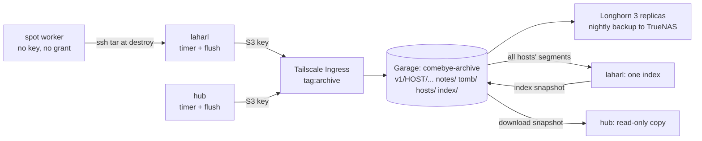

# Proposal: one central transcript archive in Garage, with one index

Status: design, awaiting the user's approval. Nothing here is built. Written
2026-11-06 against main at `0c78560`.

The user's decisions: a dedicated bucket, **plaintext stays** (`encryption
none`), the bucket lives only in the homelab, storage is protected by Longhorn
backups to TrueNAS, one index for everything, and every session records which
host produced it.

## Recommendation

- **A new single-node Garage** in its own namespace (`comebye-archive`), one
  bucket `comebye-archive`, on Longhorn with 3 replicas. It is not a bucket in
  the langfuse Garage.
- **Reached only through a Tailscale Ingress** (`tag:archive`). No Traefik host.
- **laharl and the hub write directly** with one S3 key each. The agents' session
  files are the buffer when Garage is down, so there is no local spool.
- **Spot workers hold no key.** `worker destroy` pulls their sessions over ssh to
  laharl, which uploads them under the worker's host name, before anything is
  deleted.
- **laharl builds the one index** from the whole bucket and publishes a snapshot
  to the bucket. The hub downloads it, so `comebye recall` keeps working the same
  way on both.
- **Durability:** Longhorn replicas for disk and node loss; the existing nightly
  `critical-backup` job to TrueNAS for everything else.

## What the checks found

Some of these change the design, and some correct the brief.

| Finding | How it was checked | Consequence |
|---|---|---|
| **Garage v2.5.0 ignores `If-None-Match: *` on PUT.** A second PUT returned 200 and replaced the body. 40 of 40 concurrent writers "won", in each of 5 rounds. GET does honour the header (304). | Throwaway local container, with the header confirmed on the wire by `curl -v` | The comment in `backend.go` ("S3: If-None-Match: \*") does not hold on Garage. Create-only has to come from HEAD plus one writer per host. |
| **Permissions are per key and per bucket, and write includes overwrite and delete.** A write-only key could overwrite and delete any object, but could not List or Get. | Same container | A key cannot be limited to its own host's prefix. A write-only key would also break `archive run`, which lists to find where to resume. Hosts get read and write. |
| An interrupted PUT leaves nothing visible (HEAD 404). ETag equals the MD5 of the object. Keys with spaces, `+`, `=` and `ü` round-trip. | Same container | The `Put` atomicity contract holds. ETag gives an end-to-end integrity check. |
| `aws s3 sync` copied 2,600 synthetic segments in 2.8 s; a resync found 0 differences; listing them took 0.5 s. | Same container, on loopback | Migration needs no new code. Hourly listing cost is negligible. Loopback flatters the speed, so a real network will be slower. |
| **The langfuse Garage is not in-cluster only.** It has a Traefik Ingress, `garage.jaggars.cc`, and laharl gets a 403 from it. The name resolves to 192.168.1.100 even on 1.1.1.1. | `kubectl get ingress`, `curl`, `dig` | Corrects the brief. It is LAN-reachable, and the public DNS record points at a private address. |
| **rf 1 is not one physical copy.** All six langfuse Garage volumes have 3 Longhorn replicas and `critical-backup`. Last backup today, 08:00 to 08:02 UTC. | `kubectl get volumes.longhorn.io`, `backupvolumes` | Details under [Durability](#durability). |
| The recurring-job labels are live-only. They are on the Volume objects and appear nowhere in the homelab repo. The sccache volumes are not in the backup group. | `kubectl`, `grep` of the repo | A new Garage gets **no backup** unless this is done on purpose. |
| `threadSchema` starts with `DROP TABLE threads`, and `buildThreads` works on one host. | Read `thread.go` | Calling `Sync` once per host would leave only the last host's threads. Threads must become global. |
| `recall --host` already exists. `list` matches it exactly, `threads` as a substring (`--host lah` matches laharl), and `list` output does not print the host. | Ran the CLI | Small fixes, not new work. |
| **The app has no recall today:** no mention in `web/`, no `/api/recall`. | `grep` | "CLI and app" is CLI only for now. See [Index and search](#4-central-index-and-search). |
| Worker sessions live in `~/.claude` on the **boot disk** (the bootstrap only moves code and worktrees to `/data`). AWS spot and GCE run limits both *stop* the VM. | Read `tools/worker` | Sessions survive a reclaim or idle poweroff, and die at `destroy`. Pulling at destroy is enough, but a stopped VM must be started first. |
| The hub's direct tailnet path is a LAN address (192.168.1.222). | `tailscale status --json` | It should be fast. I could not log in to the hub (ssh denied), so its figures below are from the brief. |

## 1. S3 backend

Implement the existing `Backend` interface as `S3Backend` in `internal/archive`,
using the standard library with hand-written SigV4. It needs five calls (PUT, GET,
HEAD, DELETE, ListObjectsV2 with paging). `tools/worker` already talks to HTTP APIs
this way, and an SDK would be a large dependency for so little.

- **Put:** HEAD first, and a 200 returns `ErrExists`. Otherwise PUT with
  `Content-MD5`, and compare the returned ETag. It also sends `If-None-Match: *`
  and treats a 412 as `ErrExists`, so it stays correct if Garage starts honouring
  the header.
- **Why that is safe without a real conditional:** each host writes only under
  `v1/<host>/`. In `none` mode the same bytes at the same offset produce an
  identical object, so a lost race rewrites the same content.
- **The dangerous race is same host, different length:** the timer and the
  server's flush both start from offset X and cut different lengths. That leaves
  overlapping segments, and `shipFile` then refuses the stream forever. This
  exists today, because the timer's `flock` does not cover the server. Fix: take a
  host-wide lock inside `Archiver.run`.
- **Two machines claiming one host name:** the first run writes
  `hosts/<host>.json` with the machine id. A run from a different machine is
  refused unless `--adopt-host` is given.
- **Configuration:** `COMEBYE_ARCHIVE_S3=https://HOST/BUCKET`,
  `COMEBYE_ARCHIVE_S3_CREDENTIALS=FILE` (mode 0600), region `garage`, path-style,
  `https` only except on loopback. Setting both this and `--dir` is an error. The
  server's flush reads the same settings (`main.go:263`).
- **Plaintext gate:** `none` with an S3 backend also requires
  `COMEBYE_ARCHIVE_S3_PLAINTEXT=homelab`. A typo in the URL must not send
  plaintext to some other bucket.

### Fixes needed before the backend sits on a network

Each of these is harmless on a local disk and wrong over a network.

| Where | Today | Change |
|---|---|---|
| `ship.go`, `run` | A failed tombstone List is ignored, so a network blip **re-archives a session deleted on request** | Fail the run |
| `ship.go`, `Tombstoned` | Any error means "not deleted", and it is one GET per session per index run | List `tomb/` once and fail on error |
| `config.go`, `ReadMode` | Any Get error means "no marker" | Add `ErrNotExist`; other errors fail |
| `config.go`, `EnsureMode` | A lost first-write race returns `ErrExists` as a failure | Re-read and compare |
| `cli/archive.go`, `status` | Size comes from `FSBackend` | Optional size-aware listing on the backend |

### Tombstones, delete and verify

- **Delete becomes one operation.** `archive delete SESSION --host H --yes` writes
  `tomb/<host>/...` and removes the segments. The owning host's next run sees the
  tombstone and stops copying. This replaces the "do it in each place" step in the
  current doc. The index drops the session on its next sync, and the hub's copy on
  its next pull. **Longhorn backups keep it for up to 7 days**, which is the honest
  answer to "when is it really gone".
- **`archive verify`** works unchanged with `--host`: it compares the bucket with
  the session files still on that host.
- **New: `archive verify --all-hosts --no-source`** decodes every segment (magic,
  header against key, zstd, length) and reports gaps and overlaps. It is what proves
  a restored backup, and it is the only check for sessions whose source is gone.

## 2. Which Garage, and how it is reached

**A new Garage.** The cost is one small pod and a copy of `clusters/homelab/sccache/`.

| | New single-node Garage | Bucket in the langfuse Garage |
|---|---|---|
| Who can read plaintext transcripts | Its own SOPS-encrypted secrets | Anyone with the homelab repo: `garage-values.yaml` holds the `rpcSecret` and `adminToken` in plaintext |
| Tailnet exposure | Only this bucket's endpoint | The same endpoint as `cnpg-backups` |
| Node outage | The whole bucket waits for the volume to reattach | With rf 1 across 3 nodes, part of the key space fails until that pod returns |
| Risk to other things | None | A resize mistake stalls Flux and blocks `langfuse` (happened 2026-09-13); `meta-garage-0` is already at 2.5 of 4 GB (Longhorn's actual size) |
| Work | One homelab directory | One bucket and keys |

Sizing: `longhorn-sata`, 40 Gi data and 5 Gi meta. Today's total is about 0.6 GB
stored; laharl's October was 1.9 GB raw and compresses about 5.5 times. That is
years of room at my rough estimate of up to 1 GB a month. Longhorn is thin
provisioned, and resizing is the two-step procedure that has already wedged Flux
once, so start large.

**Reach: Tailscale Ingress only**, as `llm-enmaas` does: `tag:archive`, no Traefik
host, no LAN name.

- Both hosts are devices of the user's own login, and the existing `*:*` rule
  already lets them reach a tagged node. **So no new grant is needed.**
- The policy PR adds `tagOwners` for `tag:archive` and a test that `tag:worker` is
  denied `tag:archive:443`.
- **A second tailnet user has `*:*`** too, so that account can reach the endpoint.
  It still needs an S3 key. See the decisions below.
- **Keys:** `archive-laharl` and `archive-hub`, read and write, no owner, created
  from SOPS secrets as `sccache-key.yaml` does. There is no admin token on any host.

**Unverified risk:** SigV4 signs the Host header. Tailscale's source sets
`Out.Host = In.Host` (`ipn/ipnlocal/serve.go`), so this should work, but it has not
been run against Garage. Rollout step 2 tests it first. The fallback is a Traefik
host like sccache's, LAN only.

## 3. Encryption

None, by the user's decision. Nothing in the plan uses age, recipients or
identities, and `archive rewrap` is not needed. The `age` mode stays in the code
for anyone who wants it, and a later switch is still possible, because `rewrap`
copies to a new store.

One side effect: S3 object names and bodies are all plaintext, including project
paths and session ids. Access control is therefore the only protection, as the
wording below makes explicit.

**Proposed replacement for the rule in `docs/archive.md`:**

> A plaintext archive may live in an object-store bucket only if all of these hold:
>
> 1. The bucket is on a Garage inside the homelab, used for nothing else.
> 2. Its only network path is a Tailscale Ingress. No Traefik host, no public
>    name, no website access, and `tag:worker` is denied.
> 3. Its only credentials are one per archiving host, kept in mode-0600 files
>    outside any repository. Workers hold none.
> 4. Its volumes are in Longhorn's `critical-backup` group, and any copy that leaves
>    TrueNAS is encrypted by the cloud sync. Nothing unencrypted goes to a cloud
>    drive or to another host's disk.
> 5. The plaintext index lives only on the indexing host and on hosts that download
>    its snapshot (mode 0600 in a 0700 directory), and in that same bucket. Never on
>    a worker.
>
> Transcripts contain tokens and keys. Anyone with an archive key, the index, or
> read access to the Longhorn backup dataset can read all of them.

## 4. Central index and search

**laharl builds it.** It has the disk (1.9 T, 42% used), the checkouts for the git
check, a ledger that already holds both hosts' entries (31 laharl, 25
jjaggars-kubevirt), and 20 days of uptime. The hub's `/home` is 84% full. In-cluster
would need the ledger and checkouts moved there as well as a new service, for no
gain now.

- **Reading all hosts:** `archive index --all-hosts` finds hosts from the `v1/`
  listing and runs the existing per-host `Sync` for each. Sync is already
  incremental (it compares `n_bytes`) and already scoped by host.
- **Threads become global.** `buildThreads` drops its host filter, and its per-host
  queries (about ten in `thread.go`) key on each session's own host. This is what
  makes a thread span hosts, as `docs/archive.md` already promises. Existing thread
  ids stay stable because the hash still uses the first session's host.
- **Git check:** `repoDir` tries the ledger's path and the cwd before `~/code/<repo>`,
  and those paths belong to another host. Only use them when the session is from this
  host. Also `git fetch origin` for each repo first, or work landed from the hub looks
  "not landed" against a stale local main.

**Queries: publish a snapshot; no new service.** After indexing, laharl writes a
consistent copy (`VACUUM INTO`) to `index/<time>.db.zst`, keeping the newest two.
The hub's timer downloads the newest and renames it into place. `comebye recall`
keeps opening a local SQLite file on both hosts and needs no change. Today's 149 MB
index compresses to 40 MB (zstd -3).

| | Snapshot (recommended) | HTTP API on laharl |
|---|---|---|
| Works with laharl off | Yes, up to an hour stale or older | No |
| New attack surface | None | A search API over plaintext secrets |
| Code | About one command | Routes, auth scoping, CLI client |
| Freshness | Hourly | Hourly (the index only updates hourly anyway) |
| Plaintext index on the hub | Yes, as today | No |

When the app gets a recall screen, a server endpoint can read that same local file.

**Writes still work from anywhere:** `archive summary` goes to the bucket as a note
and the next index picks it up. It needs `--host` for another host's session, and so
do `restore` and `delete`.

**Host metadata:**

- The host is already in every key (`v1/<host>/...`), in each segment's checked
  header, and in `sessions.host`, which is part of the primary key.
- `recall --host` already filters `list` and `search`. Add: an exact match for
  threads, a host column in `list` and `search` output, and the flag in the docs.
- `hosts/<host>.json` adds what the name alone cannot say: kind (workstation, hub or
  worker), provider, first seen. It feeds a small `hosts` table.
- Rollout step 4 checks that the hub's `COMEBYE_HOST_NAME` matches the ledger's
  `jjaggars-kubevirt`, because handoff links join on it.

## 5. Spot workers

**Pull at destroy, with no key on the worker.**

Minting per-worker keys, as the LLM key does, needs a Garage admin credential on
laharl and a `tag:worker` grant to the plaintext bucket. Since write means delete
for the whole bucket, any worker could then wipe every host's history. Pulling needs
none of that, and everything is sent over ssh that `destroy` already uses.

In `destroy`, after the agents stop and **before** sign-out and tailnet logout:

1. `ssh worker tar` of `~/.claude/projects` and `~/.pi/agent/sessions` into a mode-0700
   `mktemp` directory on laharl.
2. `comebye archive run --final --host NAME --claude-dir T/claude --pi-dir T/pi`.
   `--final` is new; it ships the last unterminated line.
3. `comebye archive verify --host NAME` against that directory, then delete it.
4. Continue the destroy.

- **Failure aborts before anything is deleted.** `--no-archive` overrides it.
- **A stopped VM is refused**, with a message to run `worker start` first, because
  the boot disk holds the sessions. `--no-archive` overrides this too.
- **`worker archive NAME`** runs steps 1 to 3 at any time. It is safe to repeat,
  because a run resumes from what is stored.
- **What it does not cover:** a VM deleted outside the tool, such as from a cloud
  console, loses its sessions. Workers also do not archive codex sessions, because the
  archive only knows Claude and pi.

## Durability

**What exists today**, read from the cluster:

- Job `critical-backup`: daily, retains 7, target
  `nfs://truenas.localdomain:/mnt/Mirrored/longhorn-backup`, available.
- All six langfuse Garage volumes are in it, last backed up today. The sccache
  volumes are not.
- Membership is a label on each Volume object. The `default` group label on these
  volumes does nothing, because no job uses that group.

**For the new volumes**, put it in git instead of a hand-applied label: a StorageClass
`longhorn-archive` (`diskSelector: sata`, 3 replicas,
`recurringJobSelector: [{"name":"critical-backup","isGroup":true}]`). Then check
`lastBackupAt` the next morning. Labelling by hand is the fallback, as documented in
`openclaw-shared-lab/AGENTS.md`.

**What replicationFactor 1 means here:**

| Event | Result |
|---|---|
| A disk or node fails | Fine: Longhorn has 2 more replicas and the pod reattaches. Writes wait, and hosts catch up on the next timer run. |
| Garage pod or volume is down | No reads or writes. A worker `destroy` aborts (nothing lost). Session files wait, though Claude deletes its own after 30 days. |
| A bad delete, a buggy client, a leaked key | **Replicas do not help:** all 3 copy the damage at once. Only the nightly backup does, so up to 24 h is lost, and it must be noticed within 7 days. |
| Cluster or Longhorn lost | Restore from TrueNAS. |
| TrueNAS lost as well | Everything older than 30 days is gone, and all destroyed workers' sessions, unless there is an off-site copy. See decision 3. |

**Restores need a drill.** Longhorn backs up the meta and data volumes separately: about
2 minutes apart on the langfuse volumes. A restore can have metadata pointing at blocks
that were not captured, which only affects segments written in that window. Three
mitigations: set `metadata_auto_snapshot_interval` on Garage, schedule the timer away
from the backup time, and run `verify --all-hosts --no-source` after any restore. Rollout
step 7 makes the drill a gate.

## 6. Rollout

Each step can be undone on its own. Local archives stay until step 8.

| Step | What | Who | Undo |
|---|---|---|---|
| 1 | Build the comebye changes behind the new settings; test against a local Garage in CI or a script | Agent | Unset the settings: behaviour is unchanged |
| 2 | Homelab PR: `clusters/homelab/comebye-archive/`, StorageClass, Tailscale Ingress, SOPS keys. Tailscale PR: `tag:archive` and the worker-denied test. Then smoke-test signed requests through the Ingress | Agent drafts; **user merges and supplies keys** | Revert PRs |
| 3 | Check the first Longhorn backup exists | Agent | n/a |
| 4 | laharl: `aws s3 sync` the archive, compare ETags with local MD5s, then `archive verify` against the bucket. Same on the hub | Agent, with **user placing the key files** | Delete the objects |
| 5 | Switch both hosts' `archive.env` and server settings to S3 (the server needs a restart) | Agent, **user's OK to restart** | Restore the env file; the local archive resumes from the session files |
| 6 | laharl indexes all hosts and publishes; hub pulls. Check `recall --host` for both, and a thread spanning hosts | Agent | Rebuild the old per-host index |
| 7 | **Restore drill:** restore last night's backups to a scratch Garage, `verify --all-hosts --no-source` | Agent, read-only on the real volumes | Delete the scratch copy |
| 8 | `worker destroy` with the pull, on one disposable worker | Agent | `--no-archive` |
| 9 | After a week of clean runs, retire the local archive directories (hub first, for the space) | **User's OK**, because this removes the only other copy | Not reversible, except by syncing back from the bucket beforehand |

Retiring the hub's 206 MB will not fix its 84% full `/home`, and the index on the hub
grows. Expect roughly no net change there.

## Decisions for the user

1. **A new Garage, as recommended, or a bucket in the langfuse one?** A bucket there is
   one step less work, but its secrets sit in plaintext in the homelab repo, and those
   secrets could then reach every transcript.
2. **Tailscale only, as recommended, or a LAN name too?** A second tailnet user has `*:*`
   and can reach the endpoint, though they would still need an S3 key. If that is not
   acceptable, the rule itself has to narrow.
3. **Is `/mnt/Mirrored/longhorn-backup` in an encrypted cloud sync?** Longhorn backups will
   now hold plaintext transcripts. If that dataset syncs off-site unencrypted, the rule
   above is broken. If it does not sync at all, there is no off-site copy, and the worst
   case in the table applies. I could not check TrueNAS from here.
4. **Should `destroy` refuse when the sessions cannot be saved**, as recommended, with
   `--no-archive` to override? The alternative is warning and continuing, which is the way
   to lose a worker's history by accident.
5. **Is a read-only copy of the index on the hub acceptable?** It is what the hub holds
   today (for its own sessions), but now it covers every host.

## Build plan

| Part | Contents | Rough size |
|---|---|---|
| `S3Backend` and config | SigV4, HEAD plus PUT, paging, plaintext gate, tests, server wiring | Medium |
| Network-safety fixes | The table in section 1, the host lock, `hosts/<host>.json` | Small |
| Central index | `--all-hosts`, global threads, host-scoped git candidates and fetch, `--host` fixes, publish and pull | Medium; the thread refactor is the risky part |
| Verify and flags | `--no-source`, `--final`, `--host` on restore, delete and summary | Small |
| `tools/worker` | The pull, `worker archive`, refusal rules, `--no-archive` | Small to medium |
| Docs | `docs/archive.md` (rule, config, limits), `docs/workers.md` | Small |
| Homelab and policy PRs | As in step 2 | Small |

Parallel work is possible: homelab and policy PRs, then backend plus fixes, then index and
worker changes.
